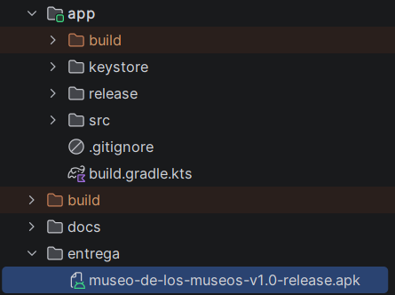
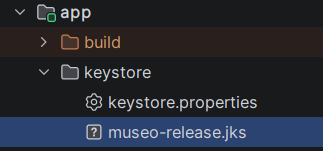

# Museo de los Museos – App móvil

Proyecto de Desarrollo de Aplicaciones Móviles (DSY1105, Duoc UC · **Evaluación Parcial 4**).

App Android (Kotlin + Jetpack Compose) que unifica el catálogo de cursos y productos museológicos (con solicitudes de compra y cálculo de envío simulado) y el Mapa de Museos Virtuales de Iberoamérica. Se conecta a **tres microservicios propios en Spring Boot** (fichas de museos, solicitudes de compra y catálogo de productos) y consume una **API externa** (obras del Art Institute of Chicago). Todos los datos son ficticios.

**Contenido**

1. [Nombre del proyecto](#1-nombre-del-proyecto)
2. [Integrantes](#2-integrantes)
3. [Funcionalidades](#3-funcionalidades)
4. [Endpoints utilizados](#4-endpoints-utilizados)
5. [Pasos para ejecutar](#5-pasos-para-ejecutar)
6. [APK firmado y llave (.jks)](#6-apk-firmado-y-llave-jks)
7. [Pruebas unitarias](#7-pruebas-unitarias)
8. [Arquitectura](#8-arquitectura)

---

## 1. Nombre del proyecto

**Museo de los Museos**: app móvil + microservicios `ms-museos`, `ms-pedidos` y `ms-productos`.

## 2. Integrantes

| Integrante | GitHub |
| --- | --- |
| Alan | [Nariyato](https://github.com/Nariyato) |
| Nicolas | [MrJa1me](https://github.com/MrJa1me) |
| Benjamin | [benjalbsp](https://github.com/benjalbsp) |
| Alanis | [AlanisVerdugo](https://github.com/AlanisVerdugo) |

## 3. Funcionalidades

### App móvil

- **Cuentas y sesión**: registro e inicio de sesión con tres roles (Administrador, Investigador y Cliente). La sesión se mantiene al cerrar la app.
- **Bienvenida y Dashboard**: panel según el rol con museos, cursos y productos destacados. El Administrador ve y **aprueba fichas pendientes** (se publican en el microservicio).
- **Mapa de museos**: OpenStreetMap (osmdroid) con los museos que entrega `ms-museos`, filtro por país, ubicación del usuario (permiso en tiempo de ejecución) y botón para **actualizar desde el servidor**.
- **Fichas de museo (CRUD completo con `ms-museos`)**: el Investigador **crea** y **edita** fichas con validación por campo; el Administrador las **aprueba**; el Investigador o el Administrador las **eliminan** (con diálogo de confirmación).
- **Obras de arte del mundo (API externa)**: búsqueda en vivo en la API del Art Institute of Chicago, con imágenes. Desde la ficha de un museo se abren las obras relacionadas con su país.
- **Favoritos** e **historial de QR** por usuario. **Lector QR** con Google Code Scanner.
- **Catálogo (CRUD con `ms-productos`)**: cursos y productos con búsqueda y filtros. El Administrador **agrega** (el servidor asigna el id), **edita** y **activa/desactiva** productos. Botón para **actualizar desde el servidor** y aviso «Sin conexión».
- **Carrito y envío**: cálculo de envío simulado. Al confirmar, la app **valida la disponibilidad en `ms-productos`**, **crea la solicitud en `ms-pedidos`** y luego **descuenta el stock en `ms-productos`**. Si un producto ya no alcanza, se avisa cuál; si un servidor no responde, el carrito queda intacto.
- **Historial de solicitudes (CRUD con `ms-pedidos`)**: el Cliente ve sus solicitudes y puede **cancelarlas** antes del envío. El Administrador **avanza su estado** (Pendiente → Confirmado → Enviado → Entregado), lo que genera un aviso para el cliente.
- **Funciona sin conexión**: si un microservicio está apagado, la app muestra la última copia guardada en Room con el aviso *"Sin conexión con el servidor"* y un botón *Reintentar*.
- **Perfil**: datos y foto (cámara o galería) y configuración por usuario. **Tema propio** con modo oscuro.

### Microservicios (Spring Boot 3.5, Java 17)

| Microservicio | Puerto | Base de datos | Qué gestiona |
| --- | --- | --- | --- |
| `ms-museos` | 8081 | H2 en archivo `data/museos` (o MySQL con el perfil `mysql`) | Fichas de museos virtuales y su aprobación |
| `ms-pedidos` | 8082 | H2 en archivo `data/pedidos` (o MySQL con el perfil `mysql`) | Solicitudes de compra, sus ítems y el flujo de estados |
| `ms-productos` | 8083 | H2 en archivo `data/productos` (o MySQL con el perfil `mysql`) | Catálogo de cursos y productos, activación y stock |

Cada uno valida los datos que recibe (`@Valid`), aplica las reglas de negocio en su capa `service` y responde los errores en JSON con el código HTTP correcto (400, 404, 409). Todos cargan los mismos datos de prueba que la app la primera vez que arrancan.

## 4. Endpoints utilizados

### Microservicio `ms-museos` (`http://<host>:8081`)

| Método | Endpoint | Uso en la app | Respuesta |
| --- | --- | --- | --- |
| GET | `/api/museos` | Sincronizar mapa, dashboard y fichas (`?publicado=true/false` para filtrar) | 200 + lista |
| GET | `/api/museos/{id}` | Obtener una ficha | 200 / 404 |
| POST | `/api/museos` | Investigador crea una ficha (queda pendiente y el servidor asigna el id `m11`, `m12`...) | 201 / 400 / 409 |
| PUT | `/api/museos/{id}` | Investigador edita una ficha | 200 / 400 / 404 |
| PATCH | `/api/museos/{id}/aprobar` | Administrador publica una ficha | 200 / 404 |
| DELETE | `/api/museos/{id}` | Investigador o Administrador elimina una ficha | 204 / 404 |

### Microservicio `ms-pedidos` (`http://<host>:8082`)

| Método | Endpoint | Uso en la app | Respuesta |
| --- | --- | --- | --- |
| GET | `/api/pedidos` | Sincronizar historial (`?userId=u03` o `?estado=PENDIENTE` para filtrar) | 200 + lista |
| GET | `/api/pedidos/{id}` | Obtener una solicitud con sus ítems | 200 / 404 |
| POST | `/api/pedidos` | Confirmar el carrito (el servidor recalcula subtotal y total) | 201 / 400 / 409 |
| PUT | `/api/pedidos/{id}` | Cambiar destino/modalidad de una solicitud pendiente (disponible en la API, sin pantalla) | 200 / 409 |
| PATCH | `/api/pedidos/{id}/estado` | Administrador avanza el estado (solo un paso a la vez) | 200 / 409 |
| DELETE | `/api/pedidos/{id}` | Cancelar una solicitud (no se permite si ya fue enviada) | 204 / 409 |

La documentación interactiva de cada microservicio está en **Swagger UI**: `http://localhost:8081/swagger-ui.html`, `http://localhost:8082/swagger-ui.html` y `http://localhost:8083/swagger-ui.html`.

### Microservicio `ms-productos` (`http://<host>:8083`)

| Método | Endpoint | Uso en la app | Respuesta |
| --- | --- | --- | --- |
| GET | `/api/productos` | Sincronizar el catálogo (`?categoria=CURSO` y/o `?activo=true` para filtrar) | 200 + lista |
| GET | `/api/productos/{id}` | Obtener un producto | 200 / 404 |
| POST | `/api/productos` | Administrador crea un producto (el servidor asigna el id según la categoría: `c05`, `p03`, `m03k`...) | 201 / 400 / 409 |
| PUT | `/api/productos/{id}` | Administrador edita un producto (no cambia si está activo) | 200 / 400 / 404 |
| PATCH | `/api/productos/{id}/activo` | Administrador activa o desactiva un producto (`{"activo": false}`) | 200 / 404 |
| DELETE | `/api/productos/{id}` | Eliminar (disponible en la API; la app usa desactivar) | 204 / 404 |
| POST | `/api/productos/disponibilidad` | Antes de confirmar el carrito: revisa stock y estado sin modificar nada | 200 + problemas |
| POST | `/api/productos/descontar-stock` | Después de crear la solicitud: descuenta el stock (todo o nada) | 200 / 409 |

### API externa: Art Institute of Chicago

| Método | Endpoint | Uso |
| --- | --- | --- |
| GET | `https://api.artic.edu/api/v1/artworks/search?q={texto}&limit=20&fields=id,title,artist_display,date_display,place_of_origin,medium_display,image_id` | Pantalla *Obras de arte del mundo* |
| GET | `https://www.artic.edu/iiif/2/{image_id}/full/400,/0/default.jpg` | Imagen de cada obra (la carga Coil) |

Es pública y no necesita clave. Sus datos **no se guardan** en Room ni en los microservicios: es información de terceros que se consulta en el momento.

## 5. Pasos para ejecutar

### Requisitos

- Android Studio (o IntelliJ con el plugin de Android), con el SDK de Android 17 (API 37).
- JDK 17 o superior para los microservicios (Android Studio ya trae uno).
- Emulador con **Google Play** (API 37) o teléfono físico. El lector QR necesita Google Play Services.

### 5.1 Levantar los microservicios

En tres terminales, desde la raíz del repositorio:

```bash
cd microservicios/ms-museos
./mvnw spring-boot:run          # Windows: mvnw.cmd spring-boot:run
```

```bash
cd microservicios/ms-pedidos
./mvnw spring-boot:run
```

```bash
cd microservicios/ms-productos
./mvnw spring-boot:run
```

Revisa que respondan: `http://localhost:8081/api/museos`, `http://localhost:8082/api/pedidos` y `http://localhost:8083/api/productos`.
También se pueden abrir como proyectos Maven en IntelliJ y ejecutar `MsMuseosApplication` / `MsPedidosApplication` / `MsProductosApplication`.

**Con MySQL** (XAMPP, Laragon, etc.) en vez de H2: inicia MySQL y ejecuta
`./mvnw spring-boot:run -Dspring-boot.run.profiles=mysql`. Las bases `museo_museos`, `museo_pedidos` y `museo_productos` se crean solas (usuario `root` sin contraseña; se cambia en `application-mysql.properties`).

### 5.2 Ejecutar la app

1. Clonar el repositorio: `git clone https://github.com/MrJa1me/museo-de-los-museos-app.git`
2. Abrir la carpeta raíz en Android Studio y esperar la sincronización de Gradle.
3. Ejecutar el módulo `app` en el emulador.

El emulador llega al PC por la IP especial **`10.0.2.2`**, que es la que viene configurada.
**En un teléfono físico** (en la misma red Wi-Fi que el PC):

1. Busca la IP del PC (`ipconfig` en Windows), por ejemplo `192.168.1.20`.
2. En `gradle.properties` agrega `msHost=192.168.1.20`.
3. En `app/src/main/res/xml/network_security_config.xml` agrega `<domain includeSubdomains="false">192.168.1.20</domain>`.
4. Vuelve a ejecutar la app.

### 5.3 Usuarios de prueba (ficticios)

| Rol | Correo | Contraseña |
| --- | --- | --- |
| Administrador | admin@museo.test | Admin123 |
| Investigador | investigador@museo.test | Invest123 |
| Cliente | cliente1@museo.test | Cliente123 |
| Cliente | cliente2@museo.test | Cliente123 |

## 6. APK firmado y llave (.jks)

| Archivo | Descripción |
| --- | --- |
| `entrega/museo-de-los-museos-v1.0-release.apk` | APK de release firmado (versión 1.0) |
| `app/keystore/museo-release.jks` | Llave de firma (alias `museo`, RSA 2048, válida hasta 2054) |
| `app/keystore/keystore.properties` | Contraseñas y alias que lee Gradle |
| `app/build.gradle.kts` | Bloque `signingConfigs { create("release") { ... } }` y `release { signingConfig = ... }` |

> La pauta exige dejar la llave y su configuración en el repositorio. En una app real el `.jks` y sus contraseñas **nunca** se suben a GitHub.

**Cómo se generó**

1. Llave: `keytool -genkeypair -v -keystore app/keystore/museo-release.jks -storetype JKS -alias museo -keyalg RSA -keysize 2048 -validity 10000` (en Android Studio: *Build → Generate Signed App Bundle / APK → APK → Create new...*).
2. Firma automática: `app/build.gradle.kts` lee `keystore.properties` y asigna la firma al tipo de compilación `release`.
3. Compilación: `./gradlew assembleRelease` → `app/build/outputs/apk/release/app-release.apk` (copiado a `entrega/`).
4. Verificación: `apksigner verify --print-certs entrega/museo-de-los-museos-v1.0-release.apk`.

**Datos de la firma**

```
Propietario: CN=Museo de los Museos, OU=DSY1105 Desarrollo de Aplicaciones Moviles, O=Duoc UC, L=Santiago, ST=RM, C=CL
Válida desde: 24-11-2026 hasta: 11-04-2054
Algoritmo: SHA384withRSA, llave RSA de 2048 bits
SHA-256: E9:96:1D:E0:2A:00:F5:BC:3A:8C:EF:BE:D7:52:46:70:74:A4:E0:D9:2D:A2:C9:8D:46:F9:5C:19:D9:04:AF:C2
apksigner: Verifies (APK Signature Scheme v2)
```

**Capturas**




## 7. Pruebas unitarias

### App móvil: 224 pruebas (JUnit 4 + MockK + kotlinx-coroutines-test)

```bash
./gradlew testDebugUnitTest   # ejecuta las pruebas
./gradlew coberturaLogica     # pruebas + reporte de cobertura JaCoCo
```

El reporte queda en `app/build/reports/jacoco/coberturaLogica/html/index.html`.

**Cobertura de la lógica: 95,2 % de líneas** (91,1 % de instrucciones). Se mide sobre `viewmodel`, `repository`, `remote`, `domain` y `model`. No incluye las pantallas Compose (se prueban en el emulador) ni el código declarativo de Room (entidades, DAO y clases generadas).

| Qué se prueba | Clases de prueba | Qué se simula |
| --- | --- | --- |
| Capa remota (Retrofit) | `MapeadoresTest`, `ErrorRemotoTest` | Respuestas HTTP de error con `Response.error(...)` |
| Repositorios con microservicio | `MuseumRepositoryRemotoTest`, `OrderRepositoryRemotoTest`, `ProductRepositoryRemotoTest` | **MockK**: la interfaz Retrofit (`MuseosApi`, `PedidosApi`, `ProductosApi`) y el DAO de Room |
| API externa | `ObrasArteRepositoryTest` | **MockK**: `ObrasArteApi` (no se llama a internet) |
| Repositorios Room | `RepositoriosRoomTest`, `HistorialQrTest` | **MockK**: los DAO |
| ViewModels | `DetalleMuseo`, `Mapa`, `EscanerQr`, `Login`, `Registro`, `Perfil`, `Catalogo`, `Favoritos`, `ObrasArte`, `Historial`, `Carrito`, `Dashboard`, `Notificaciones`, `DetalleProducto`, `FormularioProducto`, `Bienvenida` | *Fakes* en memoria (`fakes/Fakes.kt`), por ejemplo `MuseosConFallo` y `ProductosConFallo`, que simulan un servidor caído o que rechaza |
| Reglas de negocio | `CalculadoraEnvioTest`, `LectorQrTest`, `Validadores*Test`, `IdsProductoTest`, `DisponibilidadStockTest`, ... | Nada: son funciones puras |

### Microservicios: 73 pruebas (JUnit 5 + Mockito + MockMvc)

```bash
cd microservicios/ms-museos && ./mvnw test     # 20 pruebas
cd microservicios/ms-pedidos && ./mvnw test    # 24 pruebas
cd microservicios/ms-productos && ./mvnw test  # 29 pruebas
```

- `*ServiceTest`: reglas de negocio con el repositorio JPA simulado por Mockito.
- `*ControllerTest` (`@WebMvcTest`): rutas, códigos HTTP y JSON con el servicio simulado.
- `*ApplicationTests` (`@SpringBootTest`): levanta el microservicio completo con H2 en memoria y verifica los datos iniciales.

## 8. Arquitectura

### App móvil (MVVM)

```
View (Compose)  ──eventos──▶  ViewModel  ──▶  Repositorio  ──▶  Retrofit ──▶ Microservicio (fuente de verdad)
      ▲                         │ StateFlow<UiState>     │
      └────────── estado ───────┘                         └──▶  Room (copia local para funcionar sin conexión)
```

- **Escritura**: primero el microservicio; solo si responde OK se guarda su respuesta en Room. Así la app nunca muestra algo que el servidor rechazó.
- **Lectura**: la UI observa Room (`Flow`) y `sincronizar()` reemplaza esa copia con lo que tiene el servidor.

```
app/src/main/java/com/example/museo_de_los_museos_app/
├── model/        clases de datos (Museum, Order, ObraArte, ...)
├── domain/       reglas de negocio puras (CalculadoraEnvio, LectorQr, validadores)
├── remote/       Retrofit: ClienteHttp, MuseosApi, PedidosApi, ProductosApi, ObrasArteApi, dto/, Mapeadores, ErrorRemoto
├── repository/   repositorios (MuseumRepositoryRemoto, OrderRepositoryRemoto, ProductRepositoryRemoto, ObrasArteRepository, Room*)
│   └── db/       AppDatabase, entidades y DAO de Room
├── viewmodel/    un paquete por pantalla (ViewModel + UiState)
├── navigation/   rutas y NavHost
└── ui/           pantallas Compose, componentes, tema y utilidades
```

### Microservicios (capas)

```
controller  →  service  →  repository (Spring Data JPA)  →  base de datos (H2 / MySQL)
   │              │
   dto (records con @Valid)      exception (GlobalExceptionHandler → JSON con 400/404/409)
   config (DatosIniciales: carga los datos de prueba)        model (@Entity)
```

### Tecnologías

| Tecnología | Versión | Uso |
| --- | --- | --- |
| Kotlin · AGP | 2.2.10 · 9.4.1 | Lenguaje y compilación (minSdk 26, targetSdk 37) |
| Jetpack Compose (BOM) + Material 3 | 2026.02.01 | Interfaz |
| ViewModel + StateFlow · Navigation Compose | 2.8.0-rc02 · 2.7.7 | Arquitectura MVVM y navegación |
| Room (SQLite) · DataStore | 2.8.5 · 1.1.0 | Copia local y sesión |
| **Retrofit + Gson · OkHttp (logging)** | 2.11.0 · 4.12.0 | Consumo de microservicios y API externa |
| **Coil** | 3.3.0 | Imágenes de la API externa |
| osmdroid · Google Code Scanner | 6.1.20 · 16.1.0 | Mapa y QR |
| **JUnit 4 · MockK · coroutines-test · JaCoCo** | 4.13.2 · 1.14.12 · 1.7.3 | Pruebas y cobertura |
| **Spring Boot** (Web, Data JPA, Validation) · H2 · MySQL · springdoc | 3.5.16 · Java 17 | Microservicios |

## Flujo de trabajo del equipo

- `main` es la rama estable. Cada integrante trabaja en `feature/...` y los cambios entran por Pull Request revisado.
- Commits pequeños con mensajes técnicos en español. El avance se registra en Trello.

## Enlaces

- Repositorio: https://github.com/MrJa1me/museo-de-los-museos-app
- Tablero Trello: https://trello.com/b/E2TN3rMG
